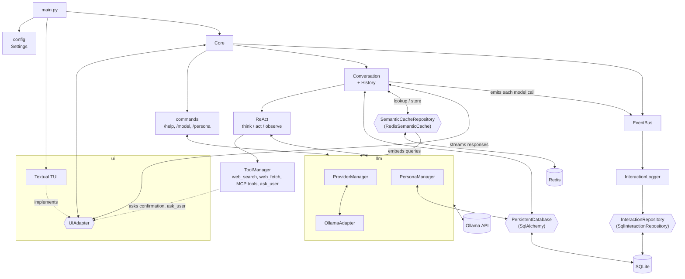
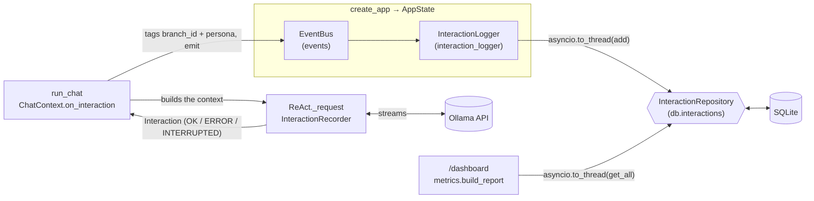
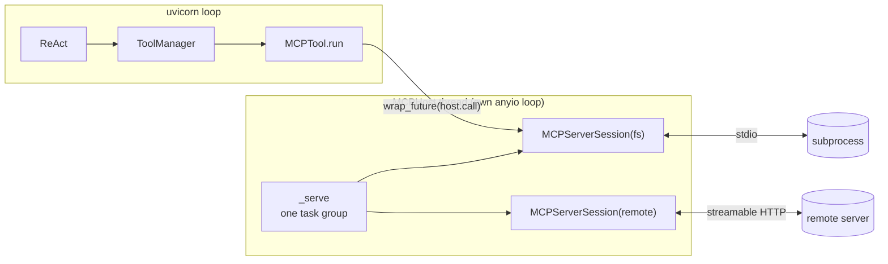

# Architecture

Message flow: the TUI pushes the user input into an event queue, and `Core` reads it and hands it to `Conversation`.
`Conversation` saves the message to the DB, then calls Ollama in streaming mode. The response chunks are sent back to
the TUI as they arrive.

Before a gated tool runs, `ToolManager` asks the user through `UIAdapter.ask_confirmation`, which opens a modal
dialog and blocks the streaming thread until it closes. `ask_user` asks its question the same way (see `technical-notes.md`, "Human in the loop").

Semantic cache: before calling the model, `Conversation` looks the query up in the cache, scoped by the model in use,
the active persona and the embedding model, and compared with the previous user messages as context. On a hit, the
cached answer is sent to the TUI and saved like any other; on a miss, the complete answer is stored with a TTL, unless
it was built with tools, whose results (web pages, search results) may soon be outdated. Without an embedding model or
a reachable Redis server, `Core` builds no cache and every query goes to the model.

Logging: every call to the model made by the ReAct loop of `Conversation` or by the RAG answer of `/ask` is recorded as
an `Interaction` (request, response, tool calls, latency, token counts, status) and published on the `EventBus`.
`InteractionLogger` subscribes to it and stores each one through `InteractionRepository`, in the `interaction` table of
the persistent database. The `[logging]` settings disable it, or drop the content and keep only the metrics. A storage
failure is reported to the UI without breaking the answer.

## Server monitoring

The server (`packages/server`) records the model calls of every session on a single, app-wide bus.

`AppState`: `create_app` builds one `EventBus` and one `InteractionLogger` for the whole server and keeps both in
`AppState` (`events`, `interaction_logger`), next to `db` and `pipeline`. The logger subscribes to `Interaction` at
startup, unless `[logging] enabled = false`. Every session emits on that same bus.

Recording: `ReAct._request` is the only place the server calls the model, so each `provider.chat` stream (think, act,
answer…) gives one `Interaction`. An `InteractionRecorder` accumulates the chunks, the first token time and the last
`ChatMetrics`. In the `finally` of the generator, the record is passed once to `ChatContext.on_interaction` with its
status: `OK`, `ERROR` (an error chunk or a `SensaiError`) or `INTERRUPTED` (closed or cancelled: `/cancel`, a new
message, logout, disconnection). The error or cancellation still propagates. `ReAct` knows neither the session nor the
bus: `run_chat` builds `on_interaction`, which tags the record with the branch and the persona and emits it, catching
and logging any subscriber failure so the answer is never broken. An answer given without the model is not recorded: a
prompt the guard rejects, or a semantic cache hit (`CacheStage` sits before the model stage). On a miss, the call is
recorded as usual and the cache stores the answer.

Async logger: `emit` and `on_interaction` are synchronous, because they run while a generator may be closing.
`InteractionLogger.log` therefore never writes inline: it strips the content when `log_content = false`, then schedules
`repository.add` in a thread as a background task and keeps it until done. A failed write is logged on the server
only. At shutdown, `_lifespan` closes the sessions first (their running calls are emitted as `INTERRUPTED`), then
awaits `drain()` so the pending writes are stored.

`/dashboard [24h|7d|30d]` reads every logged call of the period and its baseline, across all sessions, builds the
report with `monitoring/metrics.py`, and sends it to the client as a `DashboardReport`.

## Server: MCP host

The server (`packages/server`) offers the tools of external MCP servers next to its built-in tools. `MCPHost`
(`sensai_server/tools/mcp/host.py`) keeps one session open to every enabled `[mcp.<name>]` server, from startup to
shutdown, on **its own anyio event loop in a background thread**, beside uvicorn's loop:

- **Creator: `build_tools`.** `create_app` runs before uvicorn starts its loop, so `build_tools` creates the host,
  starts it (servers open concurrently, each listing its tools under `startup_timeout`), and appends one `MCPTool`
  per tool, named `<server>__<tool>`. A server that fails to start is logged and its tools are left out; the app
  still starts. `build_tools` returns the host with the tools, and `AppState.mcp` keeps it.
- **Calls.** `MCPTool.run` awaits `asyncio.wrap_future(host.call(...))`, which schedules `session.call_tool` on the
  host's loop through its portal, so uvicorn's loop never blocks. Cancelling the chat cancels the asyncio future, and
  through it the call on the host's loop. One `ClientSession` per server serves every client session at once.
- **Disconnect.** A dropped subprocess or connection is logged once; every later call to that server returns an
  `error: MCP server '<name>' disconnected…` message to the model. There is no reconnection.
- **Closer: `_lifespan`.** On shutdown, after `registry.close_all()` has cancelled the running tool calls, it runs
  `asyncio.to_thread(state.mcp.close)`, which closes every session, reaps every subprocess and stops the thread.
  `close` is idempotent: `create_app` also calls it when a later startup step fails, and `main` in a `finally` around
  `uvicorn.run`, so no thread or subprocess outlives the process.
