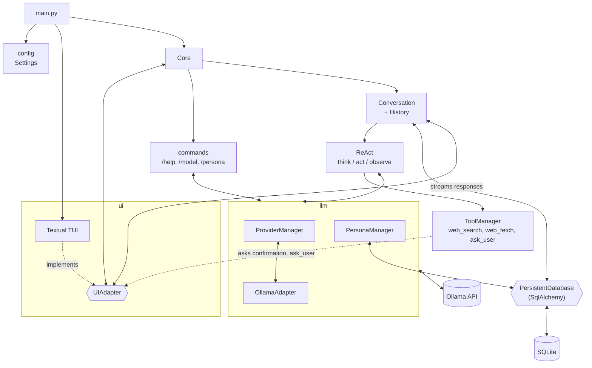

# Architecture

Message flow: the TUI pushes the user input into an event queue, and `Core` reads it and hands it to `Conversation`.
`Conversation` saves the message to the DB, then calls Ollama in streaming mode. The response chunks are sent back to
the TUI as they arrive.

Before a gated tool runs, `ToolManager` asks the user through `UIAdapter.ask_confirmation`, which opens a modal
dialog and blocks the streaming thread until it closes. `ask_user` asks its question the same way (see `technical-notes.md`, "Human in the loop").
