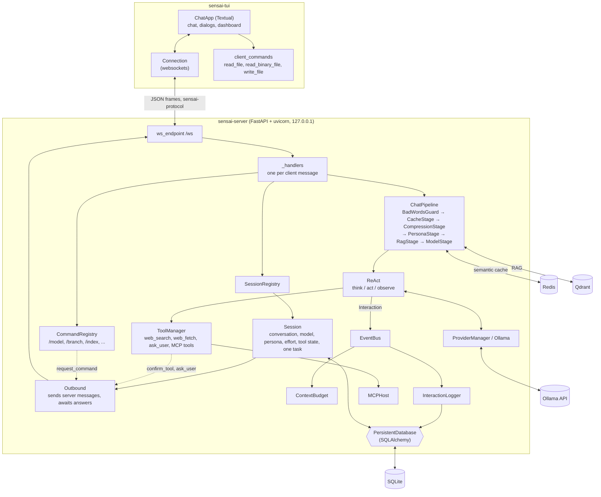
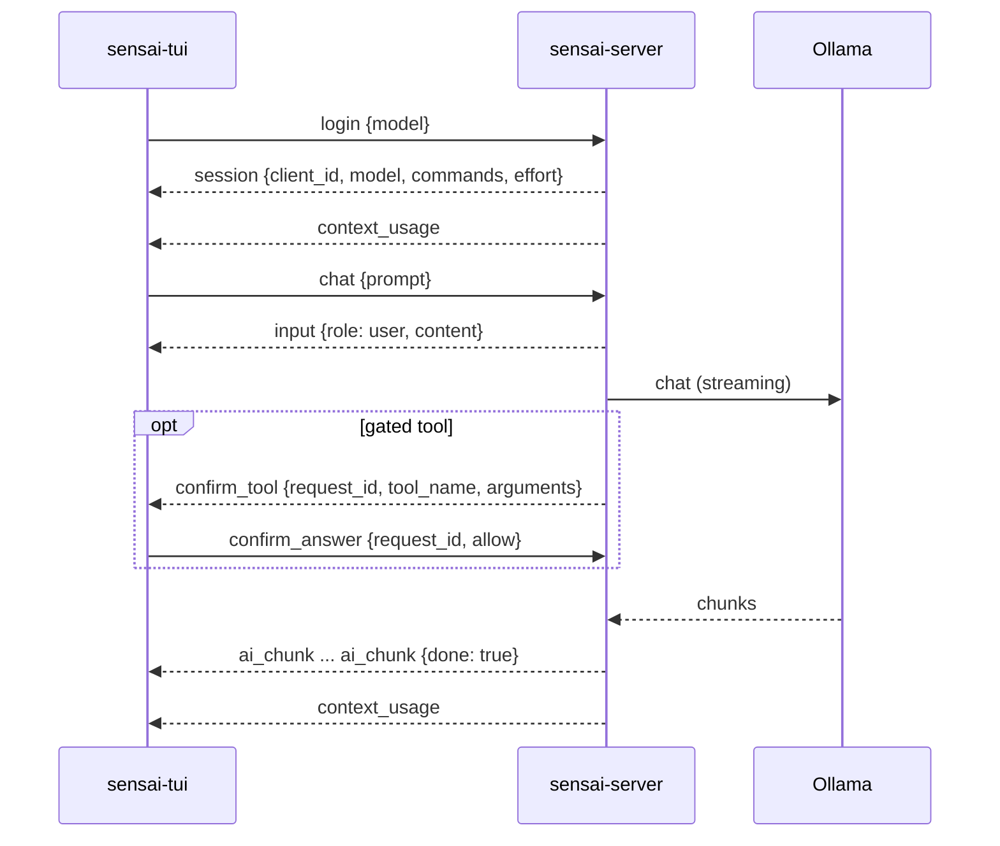
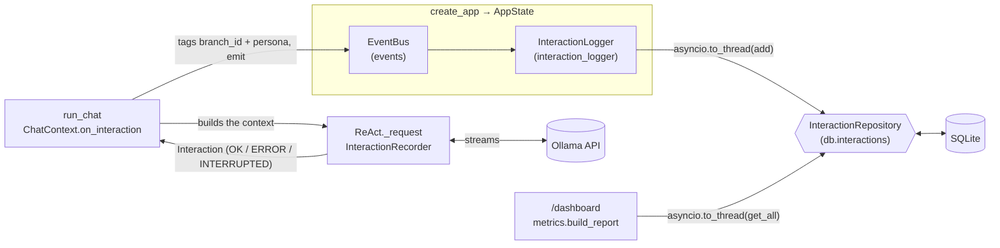
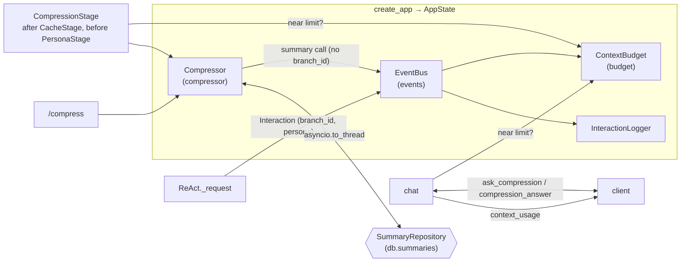
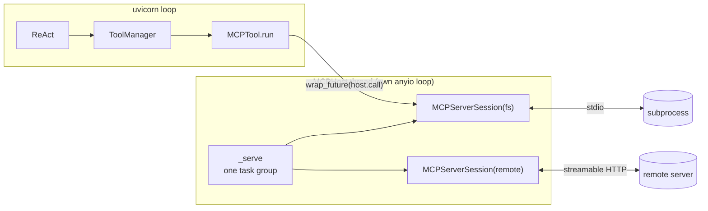

# Architecture

Sensai is a client/server application in one uv workspace of three packages:

| Package | Path | Role |
|---|---|---|
| `sensai-protocol` | `packages/protocol` | The messages both sides exchange, as pydantic models, and their parsers |
| `sensai-server` | `packages/server` | Everything that thinks: models, conversations, tools, RAG, cache, monitoring, served over a websocket |
| `sensai-tui` | `packages/client/tui` | A Textual terminal client: shows the chat, sends the user's input, runs the client commands |

The server owns every service and all the state; a client only draws what it receives and answers what it is asked.
Another client (a web UI, say) only has to speak the protocol and implement the client commands.

## Overview

### Server

- **Composition root: `create_app`** (`sensai_server/app/app.py`). It is built once, before uvicorn starts, from the
  settings file given with `--config`: the provider manager, the embedder, the tool manager and its `MCPHost`, the
  persistent database, the persona manager, the RAG, the semantic cache, the event bus with the context budget and
  the interaction logger, the compressor, the chat pipeline, the command registry and the session registry. All of
  it is kept in one typed `AppState` and shared by every client. A service that cannot start (no embedding model, no
  Redis) is logged and left out; the server still starts.
- **Endpoint: `ws_endpoint`.** One websocket per client, on `/ws`. Each text frame is parsed with
  `parse_client_message` and dispatched to its handler (`app/_handlers.py`). An invalid frame, or anything but
  `login` before a session exists, is answered with an `error` and the connection stays open. However the connection
  ends, the session is closed.
- **Session** (`session/`). `login` opens one through the `SessionRegistry`, with a fresh `client_id`. A session holds
  its conversation (branch, history, model, persona), its thinking effort, its tool state (tools disabled or allowed
  "always" for this session) and its `Outbound`. It runs at most **one task** at a time, a chat or a command: a
  second one is refused with an `error` until `cancel`, except that a task waiting for a client command is replaced
  by the new message.
- **Outbound** (`app/outbound.py`). Every server message of a connection goes through it. It also asks the client
  questions: `_ask` sends a message carrying a new `request_id` and awaits the future the matching answer resolves
  (`confirm_tool`, `ask_user`, `ask_compression`, `request_command`). Answers to those are handled even while the
  session is busy, since the busy task is the one waiting.
- **Chat** (`chat/chat.py`). The prompt is saved, then goes through the shared `ChatPipeline` (Chain of
  Responsibility, `pipeline/`). The answer is streamed back chunk by chunk as `ai_chunk`. Each model call is emitted on
  the `EventBus`, tagged with the branch and the persona.
- **Commands** (`commands/`). One `Command` object per slash command, looked up by name in the `CommandRegistry`, which
  also computes the completions. Commands run on the server; those touching the user's files go through the client
  (see [Client commands](#client-commands)).

### Client

- **`sensai-tui`** (`sensai_tui/`). `main` parses `--model` and `--port`, opens the `Connection` to
  `ws://127.0.0.1:<port>/ws` (a one-line error and exit code 1 if the server cannot be reached), then runs the
  Textual `ChatApp`, which sends `login` and reads the server messages until the socket closes.
- It keeps no state of its own beyond what the server sent: the transcript, the context gauge, the effort, the
  command names for completion. Every dialog (`ui/_dialogs.py`) answers a server question; the dashboard
  (`ui/_dashboard.py`) draws a `DashboardReport`.
- **Client commands** (`client_commands/`) run on the user's machine when the server asks (see below). A failure is
  never raised: it is sent back as the `error` of the `command_context`.

The server listens on the loopback only (`127.0.0.1`): the client must run on the same machine.

## Protocol

Every frame is one JSON object with a `type` field, which selects the message (`sensai_protocol`). Messages are
frozen pydantic models that reject unknown fields; a frame that does not parse is answered with an `error` (by the
server) or shown as one (by the client).

### Client → server (`client_messages.py`)

| `type` | Fields | Meaning |
|---|---|---|
| `login` | `model` | Open a session on `model`. Must come first |
| `logout` | | Close the session; the server closes the socket |
| `chat` | `prompt` | Send a prompt to the conversation |
| `command` | `command` | Run a command, such as `/model llama3:8b` |
| `cancel` | | Stop the running task, if any |
| `complete` | `text` | Ask for the completions of the current input |
| `confirm_answer` | `request_id`, `answer` (`allow`, `always`, `deny`) | Answer a `confirm_tool` |
| `user_answer` | `request_id`, `answer` (or null if skipped) | Answer an `ask_user` |
| `compression_answer` | `request_id`, `answer` (`compress`, `new_conversation`) | Answer an `ask_compression` |
| `command_context` | `request_id`, `command`, `ctx` or `error` | Result of a `request_command` |

### Server → client (`server_messages.py`)

| `type` | Fields | Meaning |
|---|---|---|
| `session` | `client_id`, `model`, `commands`, `effort` | Login accepted, with what the client needs to draw its UI |
| `input` | `role`, `content`, `command` | Echo of what the user sent |
| `ai_chunk` | `content`, `thinking`, `tool_calls`, `done`, `error` | One chunk of a streamed answer; the last has `done` |
| `system` | `message`, `append` | Command output or application message |
| `error` | `message` | An error to show |
| `history` | `messages` | A loaded conversation, replacing the transcript |
| `effort` | `level` | The thinking effort changed |
| `completions` | `text`, `values` | Answer to a `complete`, repeating its `text` so a stale one can be dropped |
| `context_usage` | `used`, `budget`, `warning_threshold` | Context usage of the current branch |
| `dashboard` | `report` | A monitoring report to show |
| `confirm_tool` | `request_id`, `tool_name`, `arguments` | May this tool run? |
| `ask_user` | `request_id`, `question` | A question from the model |
| `ask_compression` | `request_id`, usage fields | Compress the conversation, or start a new one? |
| `request_command` | `request_id`, `command`, `params` | Run a client command |

### A chat exchange

### Client commands

The server never touches the user's files: it asks the client, which runs the command in its own working directory
and answers with a `command_context` carrying either the result (`ctx`) or the reason it failed (`error`). The
parameters and results are checked on both sides against `CLIENT_COMMANDS` (`client_commands.py`); a client must
implement every command.

| Command | Params | Result | Used by |
|---|---|---|---|
| `read_file` | `path` | `content`: the UTF-8 text, at most 1 000 000 characters | `/index` (text, Markdown, HTML), `/import`, `/persona create` |
| `read_binary_file` | `path` | `content`: the bytes in base64, at most 8 MB before encoding | `/index` (PDF) |
| `write_file` | `path`, `content` | `path`: the absolute path written | `/export` |

The content is parsed on the server (PDF and HTML extraction, JSON import), never on the client. A new chat or
command sent while the server waits for a client command stops the waiting task.

## Server monitoring

The server (`packages/server`) records the model calls of every session on a single, app-wide bus.

`AppState`: `create_app` builds one `EventBus` and one `InteractionLogger` for the whole server and keeps both in
`AppState` (`events`, `interaction_logger`), next to `db` and `pipeline`. The logger subscribes to `Interaction` at
startup, unless `[logging] enabled = false`. Every session emits on that same bus.

Recording: `ReAct._request` is the only place the server calls the model, so each `provider.chat` stream (think, act,
answer…) gives one `Interaction`. An `InteractionRecorder` accumulates the chunks, the first token time and the last
`ChatMetrics`. In the `finally` of the generator, the record is passed once to `ChatContext.on_interaction` with its
status: `OK`, `ERROR` (an error chunk or a `SensaiError`) or `INTERRUPTED` (closed or cancelled: `/cancel`, a new
message, logout, disconnection). The error or cancellation still propagates. `ReAct` knows neither the session nor the
bus: `run_chat` builds `on_interaction`, which tags the record with the branch and the persona and emits it, catching
and logging any subscriber failure so the answer is never broken. An answer given without the model is not recorded: a
prompt the guard rejects, or a semantic cache hit (`CacheStage` sits before the model stage). On a miss, the call is
recorded as usual and the cache stores the answer.

Async logger: `emit` and `on_interaction` are synchronous, because they run while a generator may be closing.
`InteractionLogger.log` therefore never writes inline: it strips the content when `log_content = false`, then schedules
`repository.add` in a thread as a background task and keeps it until done. A failed write is logged on the server
only. At shutdown, `_lifespan` closes the sessions first (their running calls are emitted as `INTERRUPTED`), then
awaits `drain()` so the pending writes are stored.

`/dashboard [24h|7d|30d]` reads every logged call of the period and its baseline, across all sessions, builds the
report with `monitoring/metrics.py`, and sends it to the client as a `DashboardReport`.

## Server: context budget and compression

The server measures how much of the model's context each branch takes, and summarises the oldest messages of a branch
near its budget (`[context]` settings).

- **Budget on the bus.** `create_app` builds one `ContextBudget` and attaches it to the `EventBus` **before** the
  logger. `record` stores the `prompt_tokens + completion_tokens` of each branch's last call, per branch id; a call with
  no `branch_id` or no token count is ignored. It is passive: it cannot reach a session's `Outbound`, so each session
  sends `context_usage` itself (`chat/usage.py`) at login, after each answer, after `/model`, `/branch set|fork`,
  `/compress` and a new conversation. The budget is `[context] budget`, or else the model's context length
  from `provider.show`, looked up in a thread and cached per model. `/branch remove` makes it forget the branch.
  After a compression, `compressed` estimates the shorter usage (`used - tokens_before + tokens_after`), so the gauge
  drops right away; the next chat call replaces the estimate with the real measure.
- **Near-budget question.** Before saving the prompt, `chat` asks the client `ask_compression` (built on
  `Outbound._ask`, like `confirm_tool`) when the branch is near its limit. `new_conversation` leaves the branch (empty
  history, fresh `rag_id`) so that the prompt starts a new one; `compress`, or no answer, lets the stage compress.
- **Compression stage.** `CompressionStage` runs after the guard and the cache, so a cache hit never compresses, and
  before the persona and the RAG, so only the conversation's messages are summarised. Near the limit, the shared
  `Compressor` summarises all but the `keep_recent` last messages, cut before a user message, and stores the summary
  (one per branch, shielded from cancellation). It then replaces the covered messages with the summary in
  `ChatContext.messages`. A failure is a system message, and the chat goes on uncompressed.
- **Summary call.** It streams through `iterate_in_thread` and is recorded with an `InteractionRecorder` like a ReAct
  call (`OK`, `ERROR`, `INTERRUPTED`). It is emitted with the persona but **without `branch_id`**, so the budget never
  takes the summariser's prompt for the conversation's usage. `/compress` runs the same compression as the session's
  task, so `/cancel` stops it.

## Server: MCP host

The server (`packages/server`) offers the tools of external MCP servers next to its built-in tools. `MCPHost`
(`sensai_server/tools/mcp/host.py`) keeps one session open to every enabled `[mcp.<name>]` server, from startup to
shutdown, on **its own anyio event loop in a background thread**, beside uvicorn's loop:

- **Creator: `build_tools`.** `create_app` runs before uvicorn starts its loop, so `build_tools` creates the host,
  starts it (servers open concurrently, each listing its tools under `startup_timeout`), and appends one `MCPTool`
  per tool, named `<server>__<tool>`. A server that fails to start is logged and its tools are left out; the app
  still starts. `build_tools` returns the host with the tools, and `AppState.mcp` keeps it.
- **Calls.** `MCPTool.run` awaits `asyncio.wrap_future(host.call(...))`, which schedules `session.call_tool` on the
  host's loop through its portal, so uvicorn's loop never blocks. Cancelling the chat cancels the asyncio future, and
  through it the call on the host's loop. One `ClientSession` per server serves every client session at once.
- **Disconnect.** A dropped subprocess or connection is logged once; every later call to that server returns an
  `error: MCP server '<name>' disconnected…` message to the model. There is no reconnection.
- **Closer: `_lifespan`.** On shutdown, after `registry.close_all()` has cancelled the running tool calls, it runs
  `asyncio.to_thread(state.mcp.close)`, which closes every session, reaps every subprocess and stops the thread.
  `close` is idempotent: `create_app` also calls it when a later startup step fails, and `main` in a `finally` around
  `uvicorn.run`, so no thread or subprocess outlives the process.
