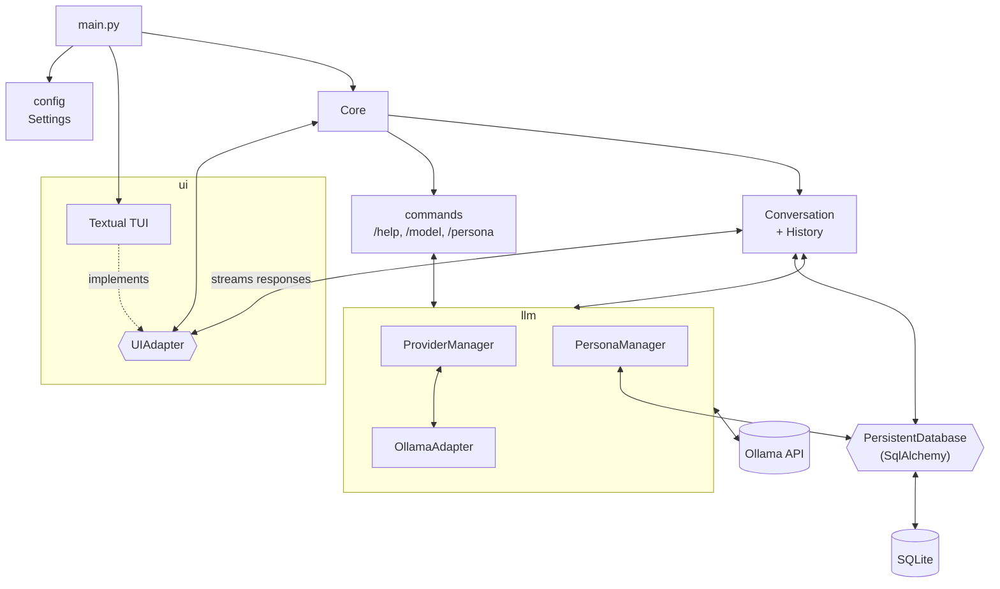

# Current architecture

State of the code on `main` @ `dadf395`.

Message flow: the TUI pushes the user input into an event queue, and `Core` reads it and hands it to `Conversation`.
`Conversation` saves the message to the DB, then calls Ollama in streaming mode. The response chunks are sent back to
the TUI as they arrive.
