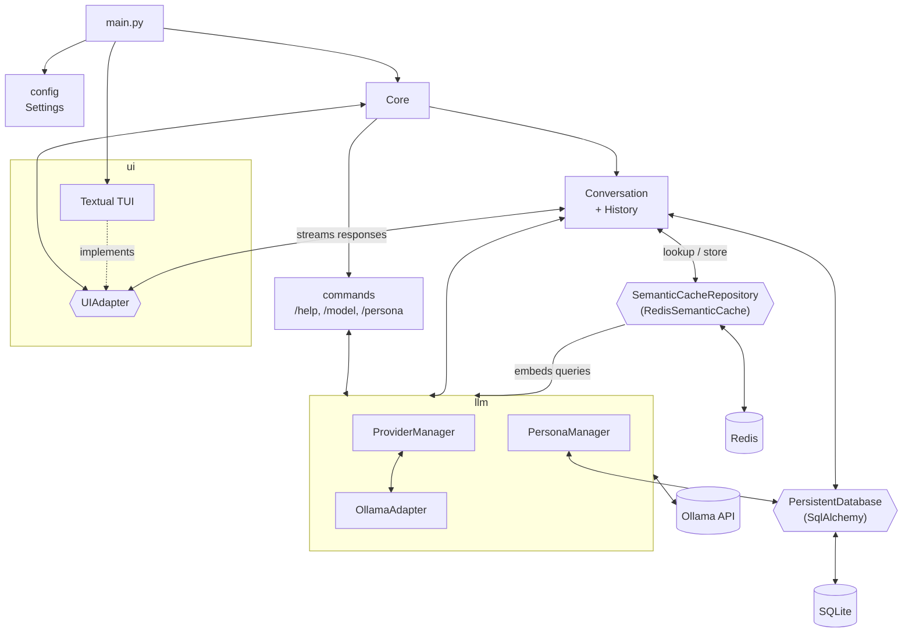

# Current architecture

State of the code on `main` @ `dadf395`.

Message flow: the TUI pushes the user input into an event queue, and `Core` reads it and hands it to `Conversation`.
`Conversation` saves the message to the DB, then calls Ollama in streaming mode. The response chunks are sent back to
the TUI as they arrive.

Semantic cache: before calling the model, `Conversation` looks the query up in the cache, scoped by the model in use,
the active persona and the embedding model, and compared with the previous user messages as context. On a hit, the
cached answer is sent to the TUI and saved like any other; on a miss, the complete answer is stored with a TTL. Without
an embedding model or a reachable Redis server, `Core` builds no cache and every query goes to the model.
